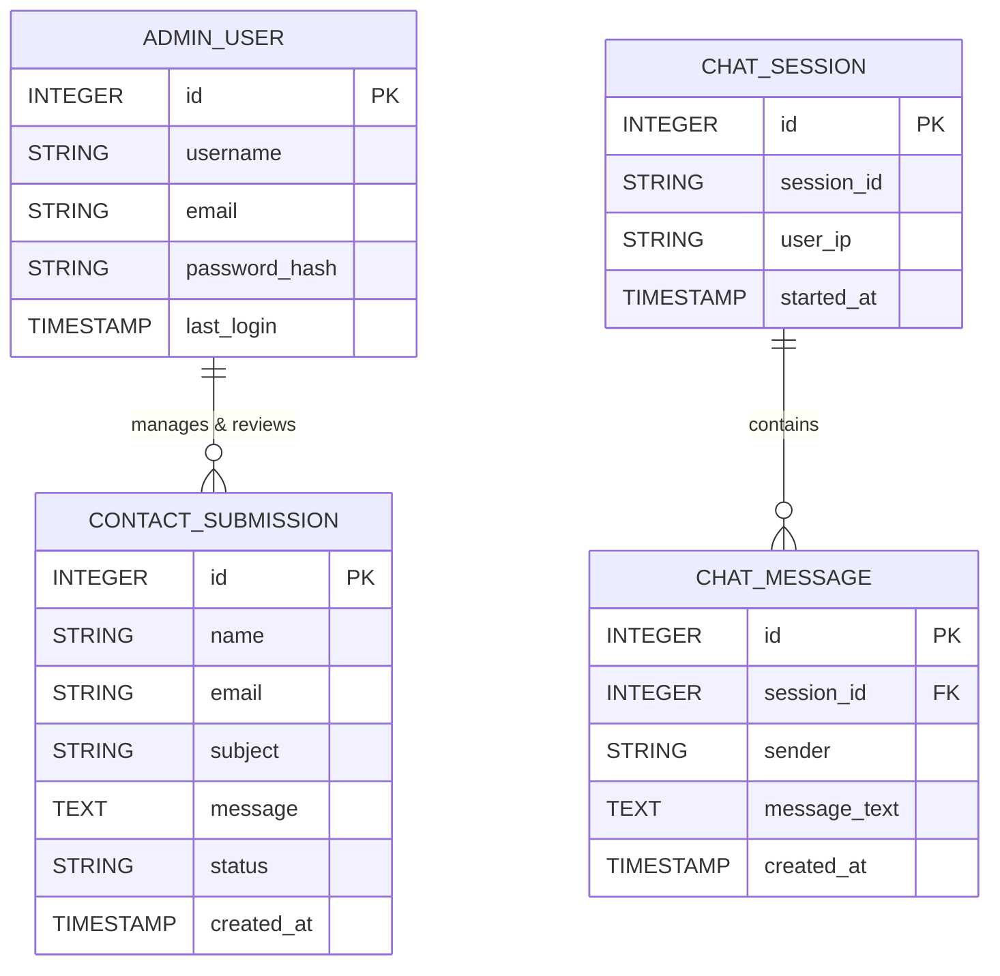
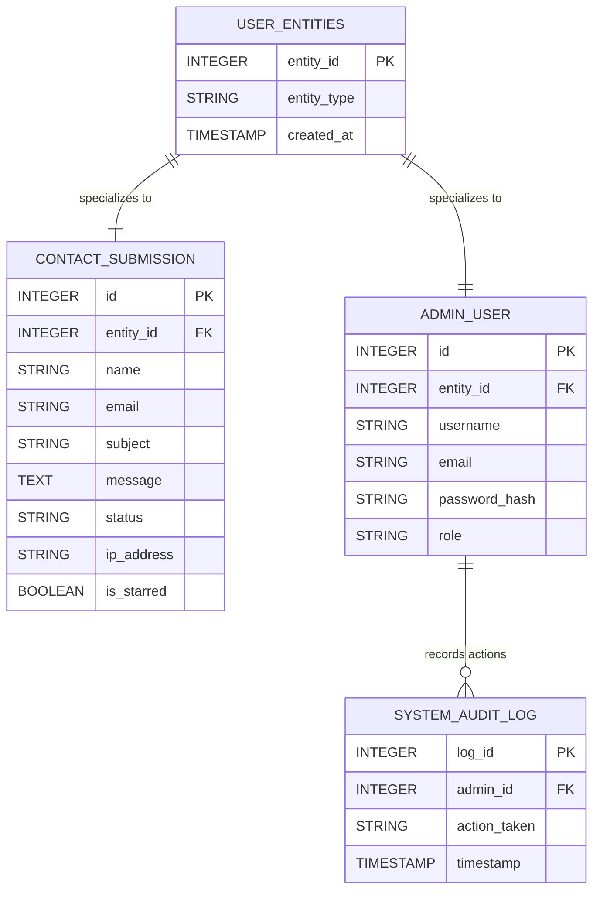
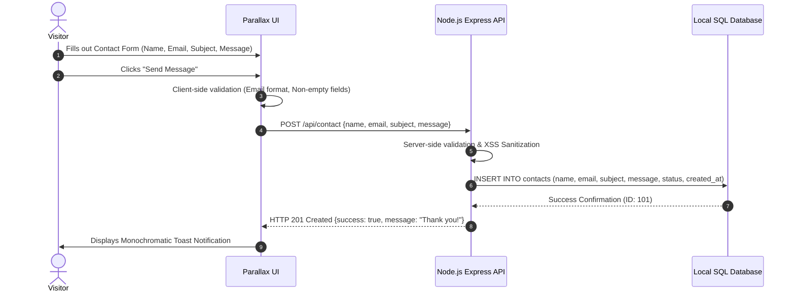
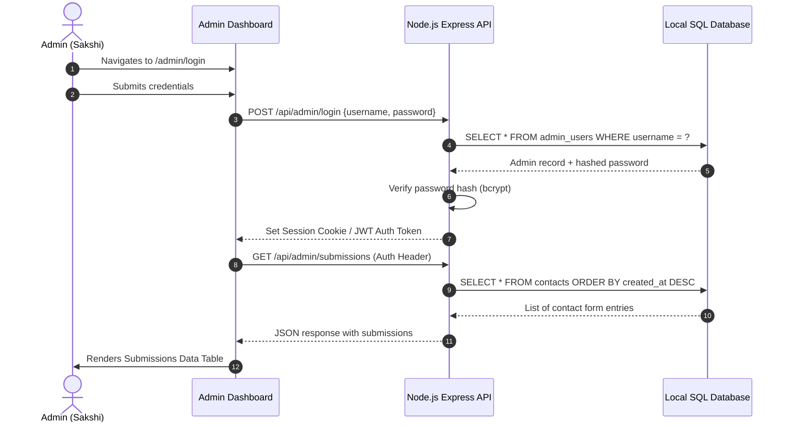

# System Architecture & Database Design

## 1. High-Level Architecture Overview

### 1D Component Diagram (Layered Pipeline)
```
[Client Browser] <---> [Node.js Express Server] <---> [Local SQLite Database Engine]
```

### 2D Architectural Layout Diagram
```
+-----------------------------------------------------------------------------------+
|                                 CLIENT SIDE BROWSER                               |
| +-------------------+  +-------------------+  +------------------+  +-----------+ |
| | Home / About /    |  | Parallax Engine & |  | Side Chatbot UI  |  | Admin UI  | |
| | Services / Contact|  | CSS Design System |  | Widget           |  | Dashboard | |
| +-------------------+  +-------------------+  +------------------+  +-----------+ |
+-----------------------------------------------------------------------------------+
                                          |
                      HTTP GET / POST (REST API & Page Routes)
                                          v
+-----------------------------------------------------------------------------------+
|                               NODE.JS BACKEND SERVER                              |
| +-------------------------------------------------------------------------------+ |
| | Express App Core Router (server.js)                                           | |
| | - Static File Middleware (Public Assets, CSS, JS)                             | |
| | - API Controller (/api/contact, /api/admin/login, /api/admin/submissions)     | |
| | - Auth Middleware (Session/JWT Admin Validation)                              | |
| | - Chatbot Intelligence API (/api/chat)                                        | |
| +-------------------------------------------------------------------------------+ |
+-----------------------------------------------------------------------------------+
                                          |
                              Native SQLite / SQL Driver
                                          v
+-----------------------------------------------------------------------------------+
|                              LOCAL SQL DATABASE (SQLite)                          |
| +--------------------------+  +-------------------------+  +--------------------+ |
| | contacts                 |  | admin_users             |  | chat_logs          | |
| +--------------------------+  +-------------------------+  +--------------------+ |
+-----------------------------------------------------------------------------------+
```

---

## 2. Entity-Relationship (ER) Diagram



---

## 3. Enhanced Entity-Relationship (EER) Diagram



---

## 4. User Flow & System Interaction Sequences

### A. Contact Form Submission Flow


### B. Admin Panel Operations Flow

